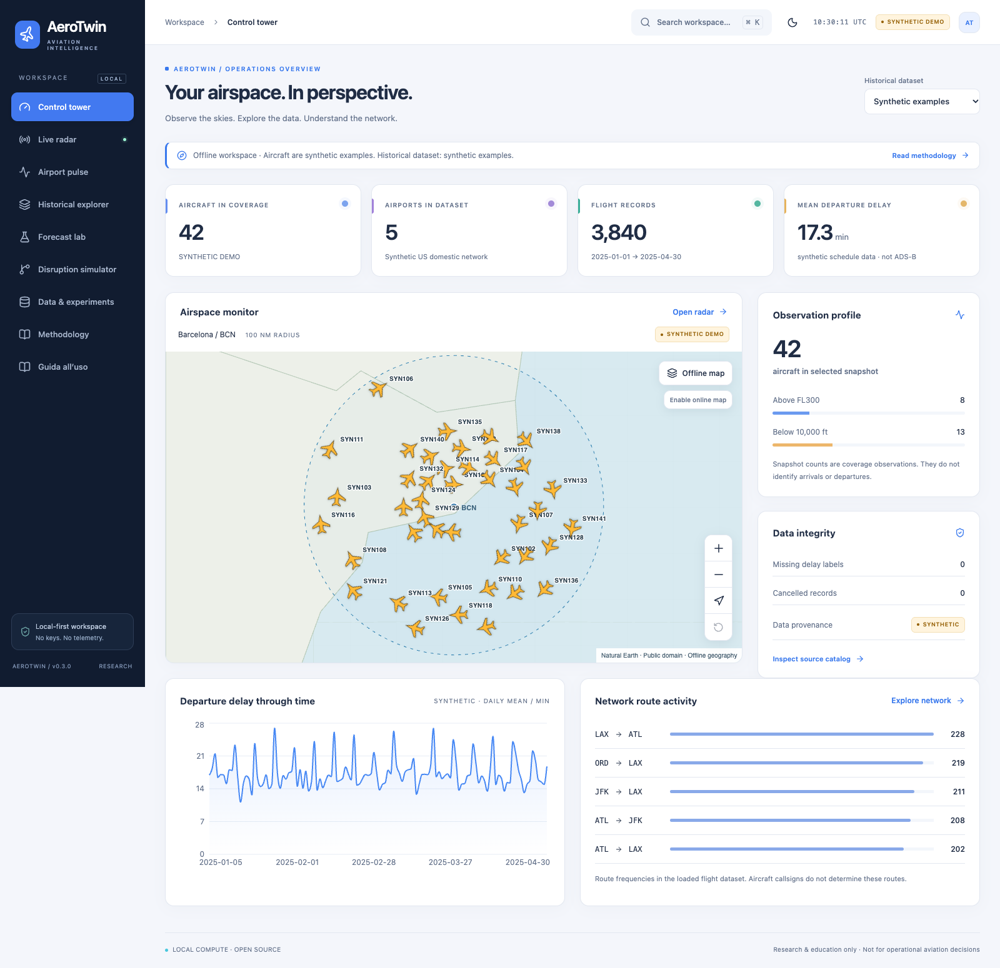
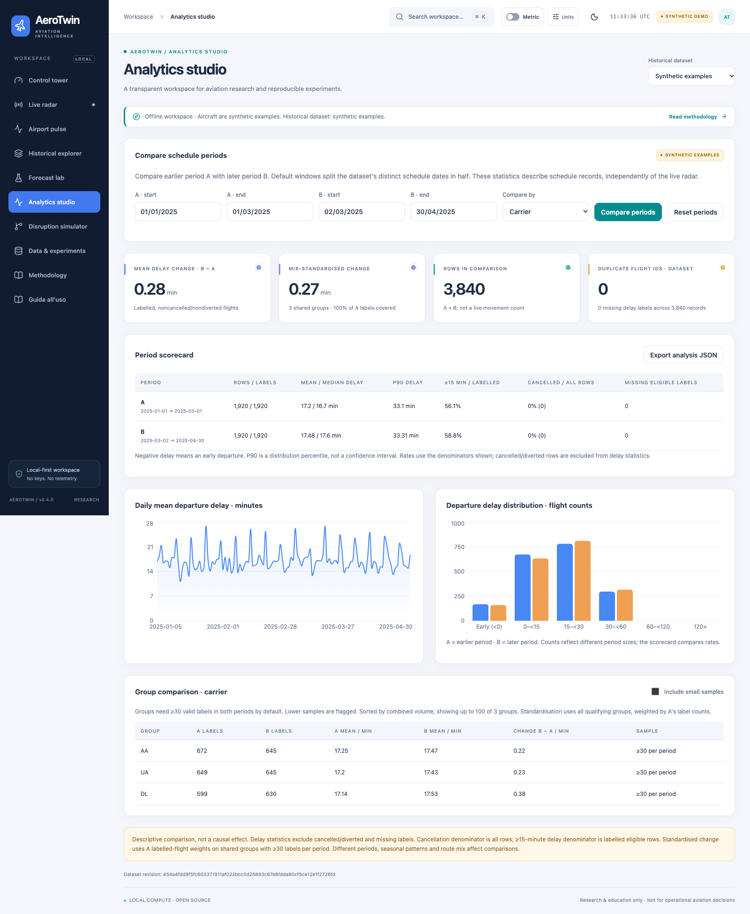
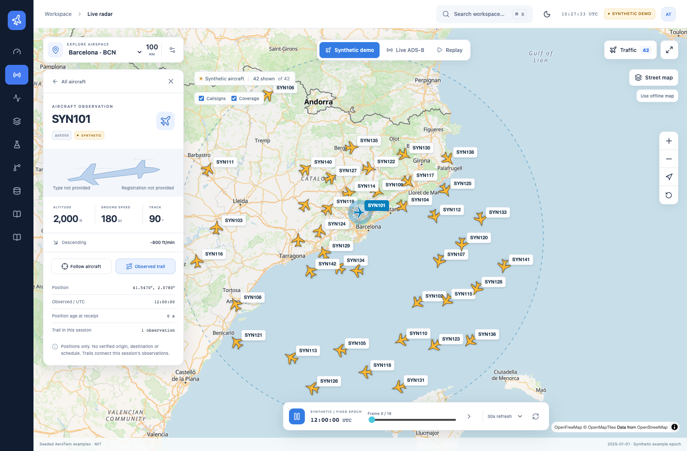

# AeroTwin

**Local-first aviation intelligence: ADS-B radar, historical analytics, temporal delay forecasting and assumption-based disruption simulation.**

[Guida completa in italiano](docs/guida-italiano.md) · [Download releases](https://github.com/massibrevo/aerotwin/releases) · [Scientific methodology](docs/methodology.md)

AeroTwin **0.4.0** runs a compiled React interface and Python API on **one local server**. No API keys, cloud account, hosted database, telemetry, GPU or LLM. First setup needs Internet for open-source dependencies; the offline demonstration then works without network. Live observations and optional online tiles require network access.

> Research, teaching and portfolio use only. No certification for dispatch, air traffic control, navigation or safety decisions. Software tests do not validate real aviation forecasting accuracy.



## Install a distribution ZIP

Download `aerotwin-0.4.0.zip` from [Releases](https://github.com/massibrevo/aerotwin/releases), extract it, install **Python 3.12 or 3.13**, and run inside the extracted directory:

```bash
python scripts/bootstrap.py
python scripts/serve.py
```

The ZIP contains the compiled frontend, so **Node is not needed** to bootstrap/run it. Python creates its own `.venv`, installs pinned dependencies, generates seeded examples and trains an actual tiny demo model. Open **http://127.0.0.1:5188** after `AeroTwin ready`. Ctrl-C stops it. A ZIP checksum and internal file manifest are provided; Python itself is not bundled.

```bash
python scripts/verify.py --base-url http://127.0.0.1:5188
```

Expected: **10/10 checks passed**. Use `--port 5190` if the default port is occupied, and change the verification URL accordingly. Existing processes are never killed by the launcher.

## Run from source

Source checkout requires Python 3.12/3.13, Node.js 20+ and npm to compile the frontend:

```bash
git clone https://github.com/massibrevo/aerotwin.git
cd aerotwin
python scripts/bootstrap.py
python scripts/serve.py
```

Use `python3.12`/`python3` if appropriate on macOS/Linux or `py -3.12` on Windows. Use `--source-build` to force a frontend rebuild. For development/testing, `python scripts/bootstrap.py --dev` installs test dependencies and compiles; `python scripts/dev.py` retains the separate Vite/API development servers.

Optional **AEROTWIN_HOME** selects a private writable state directory outside the source. Set it consistently for bootstrap, CLI and server. Without it, state stays inside the project. Existing 0.1 BTS snapshots can be read, but legacy models must be retrained. Bootstrap upgrades the demo artifact format. [Backup/update instructions](docs/guida-italiano.md#7-backup-aggiornamenti-e-manutenzione).

## Aircraft discovery and analytics studio

**0.4** adds registration/callsign/hex search, exact worldwide live lookups and browser-local favourites. Aircraft cards show sourced manufacturer/model and registered-owner details; callsign-route records remain explicitly unverified references with their source update dates.

**Analytics studio** compares schedule periods with quality checks, labelled-sample denominators, distribution plots, group changes, mix-standardisation and JSON export. **Forecast lab** adds residual diagnostics, paired date-block bootstrap comparisons against the baseline, subgroup coverage, input-support shift and recomputed per-flight sensitivity. Synthetic scores remain software demonstrations, not an aviation benchmark. [Usage, methodology and limits](docs/intelligence-v0.4.md).



## Redesigned radar and workspace

The radar opens a full-height **OpenFreeMap / OpenStreetMap street map**, with an explicit offline fallback, readable aircraft markers and collision-aware callsigns. Its floating panel switches between traffic search and an observation inspector. Follow mode moves the map to the selected aircraft; the trail connects only returned observations while this radar view is open (up to 120 points, reset on query/mode changes, rewind or leaving the page). It is not a verified flight route.

Use **Callsigns**, **Coverage**, **Aircraft filters**, the map-layer menu, zoom/recenter, expanded view and playback controls. Mobile starts with the panel closed; the Traffic button opens a bottom sheet. Demo/replay remain visibly synthetic even over a real street basemap. Street tiles need Internet; **Use offline map** immediately selects the bundled coarse basemap. No Mapbox account, key or paid map service is required.

All pages now use larger type, a brighter multi-colour layout, route accents, light/dark themes and a keyboard command menu (**Ctrl/⌘ K**). Motion respects reduced-motion preferences. Current UI dependency versions are recorded in the lockfile: Motion 14.9, Radix Tooltip 1.4.1, cmdk 1.1.1, Lucide 1.67 and Recharts 3.10.1. [UI notes](docs/radar-ui-v0.3.md).



## Working features

| Area | Implemented behavior | Meaning |
| --- | --- | --- |
| Control tower | Computed counts, quality, daily delay and route frequencies | Radar coverage and flight datasets are separate |
| Live radar | ADSB.lol, shared cache/backoff, presets/custom region, search/altitude/speed, selectable rotated aircraft, freshness | Community observations; failure is never silently synthetic |
| Offline/replay | Bundled Natural Earth map, pan/zoom, deterministic positions and 20 replay frames | Explicit synthetic examples, fixed 2025 epoch |
| Airport pulse | Dataset-aware airport controls, schedule hour bins, altitude distribution and climb/descent proxies | Not official airport movement statistics |
| History | Parameterized DuckDB filters/pagination, matching CSV export (max 500), aggregate charts | Synthetic examples or user-imported BTS schema |
| Data workspace | CSV import from browser (20 MiB) or CLI, monthly immutable Parquet snapshots and atomic active manifest | Quality/provenance is inspectable; source authenticity is user responsibility |
| Forecast lab | Actual background training, baseline/ML comparison, chronological validation/test, subgroup metrics, residual intervals, inference | Stale/damaged/incompatible models and unsupported airports/carriers are rejected |
| Simulator | Directed graph and measured centralities, real SimPy queues, paired repeated scenarios and stylized downstream slack | Hypothetical assumptions; not causal effects or calibrated operational impacts |
| Experiments | Persistent local SQLite ledger for imports/training/jobs/simulations | Survives application restart; interrupted training is marked failed |
| Guide | In-app Italian walkthrough plus detailed installation/interpretation/limitations document | Research scope stays explicit |

## Import and train BTS data

Download official Reporting Carrier On-Time Performance CSVs manually from [BTS TranStats](https://www.transtats.bts.gov/). No official raw file or observed ADS-B database is redistributed. In **Data & experiments**, select the CSV, supply missing origin airport IANA zones and import; inspect quality before training. The browser limit is **20 MiB**. Every import replaces the active dataset; combine months into one coherent CSV before importing if you need multi-month coverage. Previous snapshots remain on disk.

CLI after activating `.venv`:

```bash
python -m aerotwin.cli ingest-bts --input /path/to/bts.csv --timezone-map /path/to/zones.json
python -m aerotwin.cli train --dataset bts
```

Example timezone map: `{"SFO":"America/Los_Angeles","BOS":"America/New_York"}`. Built-in zones cover BCN/LHR/AMS/JFK/ATL/ORD/LAX/DFW. Unknown/ambiguous DST times are rejected. `2400` rolls to next-day midnight. Cancelled/diverted rows remain in analytics and are excluded from training. Stable flight keys are deduplicated. A file matching BTS's schema is not independently authenticated as an official BTS file.

Accepted columns: `FlightDate`/`FL_DATE`, `Reporting_Airline`/`OP_UNIQUE_CARRIER`/`OP_CARRIER`, `Origin`, `Dest`, `CRSDepTime`/`CRS_DEP_TIME`, `DepDelay`/`DEP_DELAY`, `Cancelled`, `Diverted`, `Distance`, `Flight_Number_Reporting_Airline`/`OP_CARRIER_FL_NUM`.

## Scientific scope

Predict **departure delay minutes at T−120 minutes** from schedule-only fields. Chronological train/validation/test windows use a conservative actual-departure +24h label-availability embargo. Validation selects ridge/gradient boosting; held-out metrics and median baseline are actually computed. Residual intervals have nominal 90% coverage and measured test coverage, not a drift-proof guarantee. Group test errors and global permutation importance are inspectable.

Bundled demo: **3,840 synthetic flights**, test MAE approximately **7.17min** versus median baseline **9.85min**. These are not real aviation benchmark results. No official BTS extract has been independently acquired/validated for this release. Generated BTS-schema fixtures in tests verify plumbing only.

Simulation: 150 uniform ready times / 360min, one FCFS equivalent runway, lognormal service mean 1.8min, bounded capacity shock at minute 60 and assumed 20–60min connection slack. Same random inputs pair baseline/scenario; zero shock yields zero added delay. Airport identity/network comes from data, but capacity/demand and propagation are not calibrated to it. No actual tail-rotation, crew, sector or weather modeling is claimed.

## Validate and package

After `bootstrap.py --dev`:

```bash
.venv/bin/python -m pytest -q
.venv/bin/ruff check backend tests/backend scripts
npm --prefix frontend test
npm --prefix frontend run build
# With production server running; from frontend:
npx playwright install chromium
AEROTWIN_URL=http://127.0.0.1:5188 npm run test:e2e
# From repository root, with all release source files tracked:
python scripts/package_release.py
```

On Windows use `.venv\Scripts\python` and PowerShell environment syntax. See [release verification](docs/evaluation-v0.4.md) and [troubleshooting](docs/troubleshooting.md). Local macOS browser checks can select installed Chrome with `AEROTWIN_BROWSER_CHANNEL=chrome`; Linux CI uses Playwright Chromium.

Code/examples **MIT**, offline Natural Earth **public domain**, ADSB.lol observations **ODbL**, optional OpenFreeMap/OSM subject to provider terms and attribution. [Sources/licenses](docs/datasets-and-licenses.md). No public-hosting authentication layer is supplied: keep the server on loopback.

[Architecture](docs/architecture.md) · [Methodology](docs/methodology.md) · [Italian guide](docs/guida-italiano.md) · [Deployment](docs/deployment.md) · [Security](SECURITY.md) · [Contributing](CONTRIBUTING.md)
