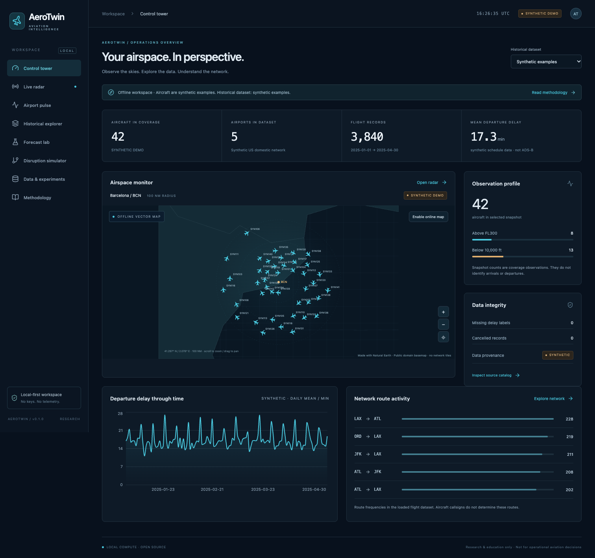

# AeroTwin

**Open-source aviation intelligence: live ADS-B radar, historical flight analytics, delay forecasting, and disruption simulation.**

A local-first aviation data science control tower. Python does the analysis; React makes assumptions, provenance and uncertainty inspectable. No API keys, account, cloud database, paid service, GPU or LLM is required to run it. Live aircraft and optional online tiles require Internet; every core workflow starts in an explicitly labeled offline synthetic demo.

> Research and education only. Not certified for dispatch, air traffic control, safety assessment or operational aviation decisions.



## Run locally

Install **Python 3.12+**, **Node.js 20+** and npm. Python 3.12/3.13 are recommended because scientific wheels may lag the newest interpreter. In the repository root:

```bash
python scripts/bootstrap.py
python scripts/dev.py
```

Open **http://127.0.0.1:5173**, with API docs at **http://127.0.0.1:8000/docs**. Bootstrap creates `.venv`, installs version-locked dependencies, generates 3,840 seeded synthetic flight records and a 20-frame synthetic replay, and **actually trains** a historical median, ridge and gradient boosting model. It saves the selected model and measured reports locally; no binary pickle is shipped in Git.

If the frontend port is occupied, use `python scripts/dev.py --frontend-port 5188` and open the printed URL. The launcher checks ports and never terminates unrelated services. Both children stop on Ctrl-C.

```bash
python scripts/verify.py                        # servers must be running
python scripts/verify.py --frontend-port 5188   # alternate frontend port
```

On macOS/Linux, activate with `source .venv/bin/activate`; on Windows PowerShell use `.venv\Scripts\Activate.ps1`. Commands below assume the environment is active. You may use `python3` instead of `python` before activation.

Manual launch in two terminals:

```bash
python -m uvicorn aerotwin.api.app:app --host 127.0.0.1 --port 8000
npm --prefix frontend run dev
```

## What works

| Workspace | Implemented behavior | Provenance |
| --- | --- | --- |
| Control tower | Computed coverage counts, flight summaries, quality checks, daily chart, route frequencies | Per-layer labels |
| Live radar | ADSB.lol observations, rotated selectable aircraft, search, altitude/speed filters, presets/custom geography, cadence/pause, freshness, details | `LIVE` only on successful real requests |
| Offline radar & replay | Bundled Natural Earth map, zoom/pan, seeded positions, frame slider, fixed observation epoch | `SYNTHETIC DEMO` / `REPLAY · SYNTHETIC` |
| Airport pulse | Schedule hour bins, observed altitude distribution and explicitly limited climb/descent proxies | Schedule and radar geography distinguished |
| Historical explorer | DuckDB parameterized filters, date/origin/search, pagination, route/airline aggregates, matching CSV export (max 500 rows) | Synthetic or explicit BTS import |
| Forecast lab | Saved Python model inference, baseline comparison, validation-selected estimator, temporal test metrics, residual interval, holdout scatter, permutation importance | `SYNTHETIC DEMO MODEL` until real training |
| Network simulator | Directed route graph, degree/betweenness/risk index, actual SimPy queues, paired repeated scenarios, downstream slack assumptions | `SIMULATION`, never causal effect |
| Data & methodology | Source terms, local import provenance, checksums, model artifacts/validation, session simulation history, scientific limitations | No hidden data sources |

No weather integration, ADSB.fi fallback, GNN, official airport movement reconstruction, tail-rotation propagation or static GitHub Pages demo is claimed. The optional online map uses MapLibre/OpenFreeMap; the offline map is the default. No unbounded tile caching.

## Import real BTS flights

Download **Reporting Carrier On-Time Performance** CSVs manually from [BTS TranStats](https://www.transtats.bts.gov/). There is no invented automatic download endpoint. Raw files stay outside Git. Start with a small official extract.

```bash
python -m aerotwin.cli ingest-bts --input /path/to/official_bts.csv
python -m aerotwin.cli train --dataset bts
```

Built-in IANA timezone mappings cover BCN/LHR/AMS/JFK/ATL/ORD/LAX/DFW. Other origin airports require an explicit JSON mapping, e.g. `{"SFO":"America/Los_Angeles","BOS":"America/New_York"}`:

```bash
python -m aerotwin.cli ingest-bts --input /path/to/bts.csv --timezone-map /path/to/zones.json
```

Accepted aliases include `FL_DATE`/`FlightDate`, `OP_UNIQUE_CARRIER`/`Reporting_Airline`, `CRS_DEP_TIME`/`CRSDepTime`, `DEP_DELAY`/`DepDelay`, and `OP_CARRIER_FL_NUM`/`Flight_Number_Reporting_Airline`. Also required: `Origin`, `Dest`, `Cancelled`, `Diverted`, `Distance`. Null departure delay is preserved. Cancelled rows have no regression target; cancelled/diverted rows are excluded from training. Exact flight keys are deduplicated. `2400` means next-day midnight; ambiguous or nonexistent local DST times are rejected. Imports replace one typed Parquet snapshot atomically and record a file checksum and quality report. This initial release uses a single Parquet snapshot rather than month partitions.

Choose **Imported BTS** in the historical dataset selector and **BTS IMPORT MODEL** in Forecast Lab after training. The radar mode is independent of the historical dataset selector.

## Reproduce & test

```bash
python -m aerotwin.cli demo
python -m aerotwin.cli train --dataset synthetic
python -m pytest -q
ruff check backend tests/backend scripts
npm --prefix frontend test
npm --prefix frontend run build
cd frontend
npx playwright install chromium
npm run test:e2e
```

Playwright requires both servers running. Set `AEROTWIN_URL` for a different frontend port. If the downloaded Chromium cannot render on your machine, `AEROTWIN_BROWSER_CHANNEL=chrome` selects installed Chrome; see [troubleshooting](docs/troubleshooting.md). CI starts local servers and runs all checks without live-provider dependence.

Read [evaluation](docs/evaluation.md) for measured local release evidence. Scores on the bundled synthetic process **are not aviation benchmark results**.

## Scientific design

The target is departure delay in minutes, issued **120 minutes before scheduled local departure** for a US domestic schedule row. Only origin/destination/carrier and schedule-derived month, weekday, hour and distance are allowed. Train/validation/test splits are chronological, with conservative label availability at actual departure +24h. Model selection uses validation MAE. A validation-residual interval reports its nominal and measured holdout coverage without guaranteeing future coverage. Expanding-origin ridge evaluations provide additional time checks.

Simulation uses 150 stylized arrivals over 360 minutes, one FCFS equivalent runway, lognormal service with mean 1.8 minutes and hypothetical capacity reduction starting at minute 60. Paired baseline/scenario share random inputs. Connection slack is assumed uniform 20–60 minutes; real aircraft rotations are **not known**. See the [didactic methodology](docs/methodology.md).

## Source terms & architecture

Code and deterministic examples: **MIT**. Offline basemap: **Natural Earth, public domain**. Live observations: **[ADSB.lol](https://api.adsb.lol/docs), ODbL**, attribution and database redistribution obligations apply. Optional tiles: **[OpenFreeMap](https://openfreemap.org/tos/)** / © OpenStreetMap contributors. Provider availability/terms may change. No observed ADS-B positions or official raw BTS data are redistributed here. [Dataset details](docs/datasets-and-licenses.md).

[Architecture](docs/architecture.md) · [Methodology](docs/methodology.md) · [Evaluation](docs/evaluation.md) · [UX](docs/ux.md) · [Deployment](docs/deployment.md) · [Contributing](CONTRIBUTING.md) · [Security](SECURITY.md)
